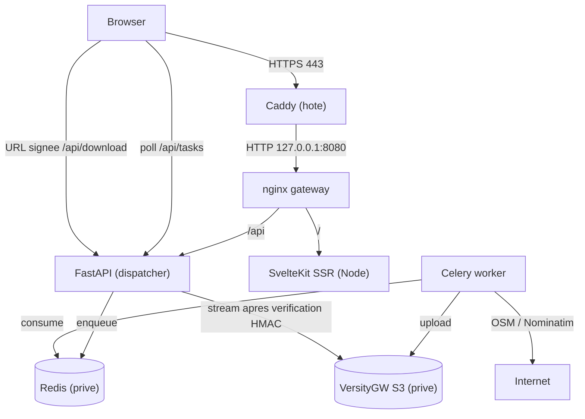

# MapPoster Web v2.2.1 🌍🎨

**Turn any location into a stunning minimalist wall art poster.**

MapPoster is a modern, microservices-based web application that generates
high-resolution map posters from OpenStreetMap data. It features a SvelteKit
frontend and a Python/FastAPI backend with Celery execution.

---

## ✨ Features

- **Global Search**: Find any city, village, or landmark worldwide.
- **WYSIWYG Preview**: Interactive OpenStreetMap preview with a dark/light CSS filter matching your theme. No tile API key.
- **Artistic Themes**: 17 built-in styles (Noir, Minimal, Blueprint, Sunset, ...) + **Custom Colors**.
- **High Resolution**: Print-ready PNG, SVG, or PDF exports up to 600 DPI.
- **Custom Layers**: Toggle cycle paths, subways, railways, rivers, forests, ...
- **Bulk Export**: Generate all themes at once as a ZIP.
- **Pro Print Settings**: A4, A3, 12x16", 30x40 cm, custom size, DPI and margins.
- **Favorites**: Save and reload configurations in the browser.
- **Session History**: Recently generated posters for the current anonymous session.
- **Mobile Friendly**: Responsive drawer controls.
- **Hardened Microservices**: Private Redis and S3 storage, signed download URLs,
  per-IP quotas, memory limits, healthchecks.

---

## 🏗️ Architecture



- **Frontend**: SvelteKit + TypeScript (adapter-node).
- **API**: FastAPI (Python 3.11). Lightweight dispatcher.
- **Worker**: Celery + OSMnx + Matplotlib. Stateless, hard memory cap.
- **Storage**: VersityGW (S3-compatible, POSIX backend) — replaces MinIO.
- **Queue**: Redis with password, no published port.
- **Gateway**: nginx, only reachable on `127.0.0.1:8080`.

Six containers: `gateway`, `web`, `api`, `worker`, `redis`, `storage`
(the five application services + the gateway).

---

## 📚 Documentation

- [**Securite**](./SECURITY.md) : modele de menace, mesures, risques residuels,
  procedure de verification et de reponse a incident.
- [**Architecture globale**](./ARCHITECTURE.md) : flux de donnees et reseaux.
- [**Frontend**](./src/README.md) : structure SvelteKit.
- [**Backend**](./backend/README.md) : FastAPI, Celery, rendu.

---

## 🚀 Quick Start (Docker)

Prerequis : Docker Engine 24+ et Docker Compose v2 (plugin `docker compose`).

```bash
git clone https://github.com/simongrossi/maptoposter-web.git
cd maptoposter-web

# Genere .env (mode 600) avec des secrets aleatoires.
./scripts/init-env.sh

# Optionnel : renseigner l'URL publique HTTPS.
# sed -i 's#^PUBLIC_BASE_URL=.*#PUBLIC_BASE_URL=https://posters.example.com#' .env

docker compose up -d --build
docker compose ps
```

Acces local : **http://127.0.0.1:8080** (ou via Caddy, voir ci-dessous).

Le premier demarrage construit les images, attend Redis et le stockage S3,
cree le bucket prive, puis demarre le gateway. Aucune commande manuelle de
provisionnement n'est necessaire.

### Verification rapide

```bash
curl -sS http://127.0.0.1:8080/api/health   # {"status":"ok"}
curl -sS http://127.0.0.1:8080/api/ready    # redis/storage ok
docker stats --no-stream "$(docker compose ps -q worker)" # MEM LIMIT = 2GiB
```

---

## ⚙️ Configuration

Toute la configuration tient dans un seul fichier `.env` (voir
[`.env.example`](./.env.example)). Les variables obligatoires n'ont **aucune
valeur par defaut** : Compose refuse de demarrer si elles sont vides.

| Variable | Role |
|---|---|
| `REDIS_PASSWORD` | mot de passe Redis (`openssl rand -hex 32`) |
| `S3_ACCESS_KEY` / `S3_SECRET_KEY` | identifiants S3 du stockage prive |
| `SESSION_SECRET` | signature des cookies de session |
| `DOWNLOAD_SIGNING_SECRET` | signature des URLs de telechargement |
| `PUBLIC_BASE_URL` | URL HTTPS publique (vide = URLs relatives) |
| `DAILY_GENERATE_QUOTA` | generations par IP et par jour (defaut 50) |
| `MAX_DISTANCE_METERS` | rayon maximal de la carte (defaut 25000) |
| `MAX_OUTPUT_PIXELS` | plafond de pixels (defaut 100 Mpx) |
| `POSTER_RETENTION_DAYS` | retention des posters (defaut 7 jours) |

Les autres variables (rate limit, plafonds de file, DPI, Sentry, logs) sont
documentees dans `.env.example`.

> Ne jamais committer `.env`. Il est deja dans `.gitignore` et exclu du
> contexte Docker par `.dockerignore`.

---

## 🖥️ Deploiement VPS derriere un reverse proxy existant

Cible : Debian 13, 4 vCPU / 4 Go / 80 Go, avec **Caddy deja installe** sur
`80/443`.

### 1. Pare-feu

N'exposer que SSH et les ports web :

```bash
sudo ufw allow 22/tcp
sudo ufw allow 80/tcp
sudo ufw allow 443/tcp
sudo ufw enable
```

Ne pas ouvrir `8080`, `6379`, `9000` ni `9001`.

### 2. Recuperer et configurer le projet

```bash
sudo mkdir -p /opt/maptoposter
sudo chown "$USER":"$USER" /opt/maptoposter
git clone https://github.com/simongrossi/maptoposter-web.git /opt/maptoposter
cd /opt/maptoposter

./scripts/init-env.sh
sed -i 's#^PUBLIC_BASE_URL=.*#PUBLIC_BASE_URL=https://posters.example.com#' .env
```

`./scripts/init-env.sh` genere `REDIS_PASSWORD`, `S3_ACCESS_KEY`,
`S3_SECRET_KEY`, `SESSION_SECRET` et `DOWNLOAD_SIGNING_SECRET`, puis applique
`chmod 600 .env`.

### 3. Caddy

`/etc/caddy/Caddyfile` :

```caddyfile
posters.example.com {
    encode zstd gzip
    reverse_proxy 127.0.0.1:8080
}
```

```bash
sudo systemctl reload caddy
```

Caddy termine le TLS et l'HSTS, puis proxifie vers le gateway nginx. nginx
lit l'IP cliente dans `X-Forwarded-For` et transmet `X-Real-IP` a l'API.

### 4. Demarrer

```bash
cd /opt/maptoposter
docker compose up -d --build
docker compose ps
```

### 5. Verifier l'exposition

```bash
sudo ss -ltnp | grep -E ':(80|443|8080|6379|9000|9001)\b'
# 80/443 : Caddy
# 8080  : 127.0.0.1 uniquement (Docker)
# 6379, 9000, 9001 : absents

curl -sS https://posters.example.com/api/health
```

`docker compose port redis` et `docker compose port storage` ne doivent rien
afficher.

### 6. Mises a jour

```bash
cd /opt/maptoposter
git pull
docker compose build
docker compose up -d
```

Les volumes (`redis_data`, `posters_data`, `osm_cache`) sont conserves.

### 7. Sauvegarde / retention

- `posters_data` contient les affiches (donnees potentiellement personnelles).
  La retention applicative supprime les objets de plus de
  `POSTER_RETENTION_DAYS` jours, au plus une fois par heure.
- `redis_data` contient la file et les resultats Celery (TTL 1 h).
- `osm_cache` contient les graphes OSM (pas de donnees personnelles).
- Pour une sauvegarde complete : `docker compose stop`, copier les volumes,
  puis `docker compose start`. Ne pas copier un volume Redis en cours
  d'ecriture sans precaution.

---

## 🧪 Tests

**Backend**

```bash
python -m venv .venv
. .venv/bin/activate
pip install -r requirements-dev.txt
pytest
```

**Frontend**

```bash
npm ci
npm run check
npm run build
```

**Validation Compose**

```bash
docker compose config --quiet
```

---

## 🛡️ Security summary

- Redis and S3 storage are on an `internal: true` Docker network, with no
  published ports and no anonymous access.
- Posters are only served through expiring HMAC-signed URLs
  (`/api/download/...`); the bucket stays private.
- `POST /generate` is protected by a signed anonymous session, a per-IP daily
  quota, a per-session concurrency cap and a global queue cap.
- All inputs are validated (theme path, format, distance, dimensions, DPI,
  pixel count, custom layers/colors).
- Every container has a memory/CPU limit, a restart policy and a healthcheck
  where applicable; the worker is capped at 2 GiB and recycles after each task.
- All images are pinned. No default credential exists in the repository.

See [SECURITY.md](./SECURITY.md) for the threat model, residual risks and the
post-deployment verification checklist.

---

## 👨‍💻 Author

Developed by **Simon Grossi**.

## 📜 License

MIT License.
Data © OpenStreetMap contributors.
Map tiles © OpenStreetMap contributors.
