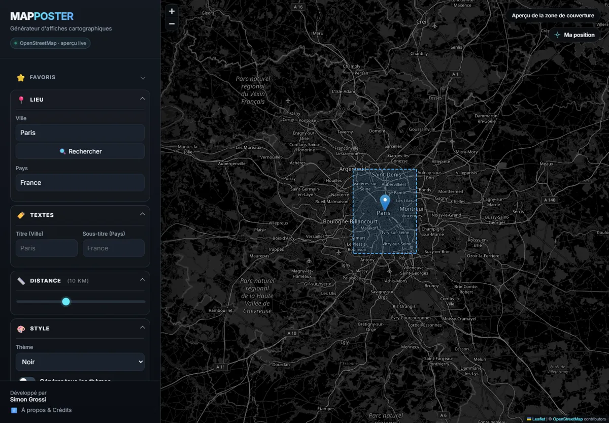
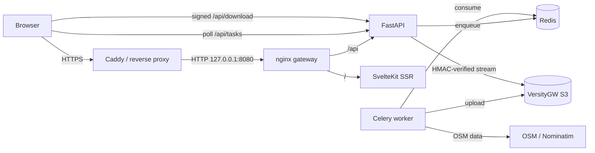

# MapPoster

**Turn any place on OpenStreetMap into a print-ready, minimalist map poster.**

[](https://github.com/simongrossi/maptoposter-web/actions/workflows/ci.yml)
[](https://www.python.org/)
[](https://nodejs.org/)
[](https://docs.docker.com/compose/)
[](SECURITY.md)
[](LICENSE)

MapPoster is a self-hosted web application that generates high-resolution map
posters from OpenStreetMap data. It combines a SvelteKit frontend, a FastAPI
dispatcher, a Celery worker, Redis, and a private S3-compatible object store.
The stack is designed for a single VPS behind an existing reverse proxy.



---

## Table of contents

- [Features](#features)
- [Architecture](#architecture)
- [Tech stack](#tech-stack)
- [Quick start](#quick-start)
- [Configuration](#configuration)
- [VPS deployment with Caddy](#vps-deployment-with-caddy)
- [API overview](#api-overview)
- [Preview tiles](#preview-tiles)
- [Development](#development)
- [Operations](#operations)
- [Security](#security)
- [Troubleshooting](#troubleshooting)
- [License and credits](#license-and-credits)

---

## Features

| Category | Details |
|---|---|
| **Search** | Geocode any city, village, or landmark through a bounded Nominatim proxy. |
| **Preview** | Interactive Leaflet map using OpenStreetMap Standard tiles. No tile API key. Dark and minimal themes use a CSS filter on the tile pane. |
| **Geolocation** | A “My location” control uses the browser Geolocation API to center the map on the visitor and reverse-geocode the position. |
| **Themes** | 17 built-in styles (Noir, Minimal, Blueprint, Sunset, …), plus custom colors. |
| **Export** | PNG, SVG, or PDF up to 600 DPI, with A4, A3, 12×16 in, 30×40 cm, and custom paper sizes. |
| **Layers** | Optional cycle paths, railways, subway lines, forests, rivers, and other OSM features. |
| **Bulk generation** | Render every theme in one request and download the result as a ZIP. |
| **Persistence** | Browser-local favorites and a session-scoped history of generated posters. |
| **Mobile** | Responsive layout with an off-canvas controls drawer. |
| **Hardening** | Private Redis and S3 storage, signed download URLs, quotas, ownership checks, memory limits, and healthchecks. |

---

## Architecture



The deployment contains six containers:

| Container | Responsibility | Public port |
|---|---|---|
| `gateway` | nginx reverse proxy and security layer | `127.0.0.1:8080` |
| `web` | SvelteKit SSR frontend | none |
| `api` | FastAPI dispatcher, sessions, quotas, signed URLs | none |
| `worker` | Celery, OSMnx, Matplotlib rendering | none |
| `redis` | Celery broker and short-lived results | none |
| `storage` | VersityGW private S3 bucket | none |

Redis and storage share an `internal: true` Docker network. Only the gateway
publishes a port, and only on the loopback interface.

---

## Tech stack

| Layer | Technology |
|---|---|
| Frontend | SvelteKit 2, Svelte 5, TypeScript, Leaflet |
| API | FastAPI, Pydantic, SlowAPI, Redis |
| Worker | Celery, OSMnx, GeoPandas, Matplotlib, boto3 |
| Storage | VersityGW (S3-compatible, POSIX backend) |
| Queue | Redis 7 with password authentication |
| Gateway | nginx 1.28 on an internal network |
| Runtime | Python 3.11, Node.js 22 |
| Deployment | Docker Compose v2 |

All container images are pinned. The API and worker share one image; the
frontend has its own multi-stage image.

---

## Quick start

Requirements: Docker Engine 24+ and the Docker Compose v2 plugin.

```bash
git clone https://github.com/simongrossi/maptoposter-web.git
cd maptoposter-web

# Create .env with random secrets, mode 600.
./scripts/init-env.sh

# Optional: set the public HTTPS origin.
sed -i 's#^PUBLIC_BASE_URL=.*#PUBLIC_BASE_URL=https://posters.example.com#' .env

docker compose up -d --build
docker compose ps
```

Open **http://127.0.0.1:8080** locally, or the public URL served by Caddy.

On first start the API waits for Redis and the storage service, creates the
private bucket, then the gateway becomes available. No manual bucket or
database provisioning is required.

### Health checks

```bash
curl -sS http://127.0.0.1:8080/api/health   # {"status":"ok"}
curl -sS http://127.0.0.1:8080/api/ready    # {"status":"ready","checks":{...}}

docker compose ps
docker stats --no-stream "$(docker compose ps -q worker)"
```

The worker limit should be shown as `2GiB`.

---

## Configuration

All configuration lives in a single `.env` file. Required variables have **no
default value**: Compose refuses to start if they are missing. See
[`.env.example`](.env.example) for the complete list.

| Variable | Purpose |
|---|---|
| `REDIS_PASSWORD` | Redis password, generated with `openssl rand -hex 32` |
| `S3_ACCESS_KEY` / `S3_SECRET_KEY` | Private S3 credentials |
| `SESSION_SECRET` | HMAC key for anonymous session cookies |
| `DOWNLOAD_SIGNING_SECRET` | HMAC key for download URLs |
| `PUBLIC_BASE_URL` | Public HTTPS origin; leave empty for relative URLs |
| `DAILY_GENERATE_QUOTA` | Generations per IP per day (default `50`) |
| `MAX_ACTIVE_JOBS_PER_SESSION` | Concurrent jobs per session (default `2`) |
| `MAX_QUEUED_JOBS` | Global Celery queue cap (default `20`) |
| `MAX_DISTANCE_METERS` | Maximum map radius (default `25000`) |
| `MAX_OUTPUT_PIXELS` | Maximum output size (default `100000000`) |
| `POSTER_RETENTION_DAYS` | Poster retention (default `7`) |
| `MAX_STORED_POSTERS` | Maximum stored objects (default `2000`) |

Advanced settings (task timeouts, worker recycle threshold, queue name,
Nominatim user agent, Sentry, log level) are documented in `.env.example`.

> **Never commit `.env`.** It is ignored by Git and excluded from the Docker
> build context by `.dockerignore`.

---

## VPS deployment with Caddy

Target: Debian 13, 4 vCPU, 4 GB RAM, 80 GB disk, with Caddy already owning
ports 80 and 443.

### 1. Firewall

```bash
sudo ufw allow 22/tcp
sudo ufw allow 80/tcp
sudo ufw allow 443/tcp
sudo ufw enable
```

Do not open `8080`, `6379`, or `8333`.

### 2. Install the project

```bash
sudo mkdir -p /opt/maptoposter
sudo chown "$USER":"$USER" /opt/maptoposter
git clone https://github.com/simongrossi/maptoposter-web.git /opt/maptoposter
cd /opt/maptoposter

./scripts/init-env.sh
sed -i 's#^PUBLIC_BASE_URL=.*#PUBLIC_BASE_URL=https://posters.example.com#' .env
```

### 3. Configure Caddy

`/etc/caddy/Caddyfile`:

```caddyfile
posters.example.com {
    encode zstd gzip
    reverse_proxy 127.0.0.1:8080
}
```

```bash
sudo systemctl reload caddy
```

Caddy terminates TLS and HSTS, then forwards to the gateway. nginx resolves the
real client IP from `X-Forwarded-For` and forwards `X-Real-IP` to the API.

### 4. Start the stack

```bash
cd /opt/maptoposter
docker compose up -d --build
docker compose ps
```

### 5. Verify exposure

```bash
sudo ss -ltnp | grep -E ':(80|443|8080|6379|8333)\b'
# 80/443: Caddy
# 8080: 127.0.0.1 only
# 6379 and 8333: absent

curl -sS https://posters.example.com/api/health
```

`docker compose port redis` and `docker compose port storage` must return no
published port.

### 6. Updates

```bash
cd /opt/maptoposter
git pull
docker compose build
docker compose up -d
```

Named volumes (`redis_data`, `posters_data`, `osm_cache`) are preserved.

---

## API overview

The public API is exposed under `/api` by the gateway.

| Method | Route | Description |
|---|---|---|
| `POST` | `/api/generate` | Validate and enqueue a poster job |
| `GET` | `/api/tasks/{id}` | Poll job status and progress (session owner only) |
| `GET` | `/api/download/{key}` | Stream a poster after HMAC signature verification |
| `GET` | `/api/history` | Recent posters for the current anonymous session |
| `GET` | `/api/themes` | List available themes |
| `GET` | `/api/geocode?q=...` | Bounded Nominatim forward-geocoding proxy |
| `GET` | `/api/health` | Process liveness |
| `GET` | `/api/ready` | Redis and storage readiness |

Interactive OpenAPI documentation is disabled by default
(`ENABLE_DOCS=false`).

---

## Preview tiles

The interactive preview uses **OpenStreetMap Standard** tiles:

```
https://tile.openstreetmap.org/{z}/{x}/{y}.png
```

No tile API key is required. Dark and minimal themes are rendered by applying a
CSS filter to Leaflet's tile pane, so the preview remains a single free tile
source.

The generated poster itself is built from OSM data through OSMnx, Overpass, and
Nominatim; it does not use raster tiles.

> [!NOTE]
> The public OSM tile service is subject to the
> [OSM tile usage policy](https://operations.osmfoundation.org/policies/tiles/).
> For high traffic, self-host tiles or use a dedicated tile provider.

---

## Development

### Backend

```bash
python -m venv .venv
. .venv/bin/activate
pip install -r requirements-dev.txt
pytest
```

The test suite uses a fake Redis and a fake Celery dispatcher. Heavy rendering
tests are skipped automatically when Matplotlib/OSMnx are not installed.

### Frontend

```bash
npm ci
npm run check
npm run build
```

### Compose validation

```bash
docker compose config --quiet
```

---

## Operations

| Resource | Behavior |
|---|---|
| `posters_data` | Private posters; deleted after `POSTER_RETENTION_DAYS` and beyond `MAX_STORED_POSTERS` |
| `redis_data` | AOF-backed Celery queue and results (results expire after 1 hour) |
| `osm_cache` | OSM graphs and geocoding cache; no personal data |
| Logs | Docker `json-file`, rotated at 10 MB × 3 |
| Restart | `unless-stopped` on every service |

For a consistent volume backup, stop the stack before copying the volumes:

```bash
docker compose stop
# copy the volumes
docker compose start
```

---

## Security

Security is part of the design, not an add-on:

- Redis and S3 storage have no published ports and live on an internal network.
- The S3 bucket is private; posters are served only through expiring HMAC-signed
  URLs streamed by the API.
- `POST /generate` is protected by an anonymous signed session, per-IP quota,
  per-session concurrency cap, and a global queue cap.
- Inputs are validated: theme path, format, distance, dimensions, DPI, pixel
  budget, OSM tag charset, and custom colors.
- The worker is capped at 2 GiB, runs one task at a time, and recycles its child
  process after every task.
- Containers use pinned images, non-root users where possible, dropped
  capabilities, and `no-new-privileges`.

The full threat model, residual risks, and post-deployment checklist are in
[SECURITY.md](SECURITY.md).

---

## Troubleshooting

| Symptom | Cause / fix |
|---|---|
| `ports are not available: 127.0.0.1:8080` | Another process owns port 8080. Stop it or change the host port in `docker-compose.yml`. |
| Map tiles are blank | OSM tile service unreachable or blocked by the browser/network. Check the browser console and the OSM usage policy. |
| “API KEY REQUIRED” on the map | An old frontend build still references CARTO tiles. Rebuild `web`: `docker compose build web && docker compose up -d web`. |
| “My location” does nothing | The site must be served over HTTPS, and the browser must grant geolocation permission. |
| Generation takes a long time or fails with “No map data” | Overpass/Nominatim may be slow or rate-limiting. Retry, reduce the distance, or self-host the geocoding/Overpass service. |
| 413 on generate | Request body exceeds the 64 KB gateway limit. |
| 403 on a poster URL | The signed URL expired. Reload the history or regenerate the poster. |

---

## License and credits

MIT License. See [LICENSE](LICENSE).

- Map data © [OpenStreetMap contributors](https://www.openstreetmap.org/copyright), available under the ODbL.
- Built with [OSMnx](https://github.com/gboeing/osmnx), [Matplotlib](https://matplotlib.org/), [FastAPI](https://fastapi.tiangolo.com/), and [SvelteKit](https://svelte.dev/).
- Original poster concept by [Ankur](https://github.com/originalankur/maptoposter), adapted for the web by [Simon Grossi](https://github.com/simongrossi).
